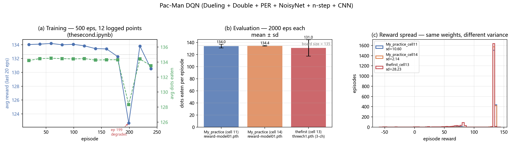
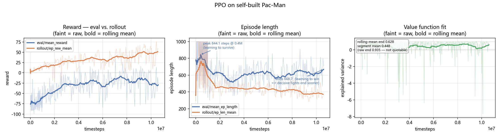
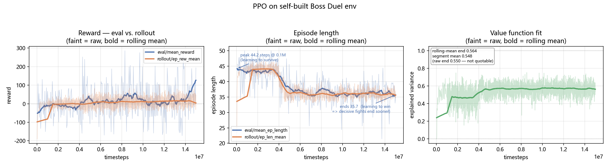
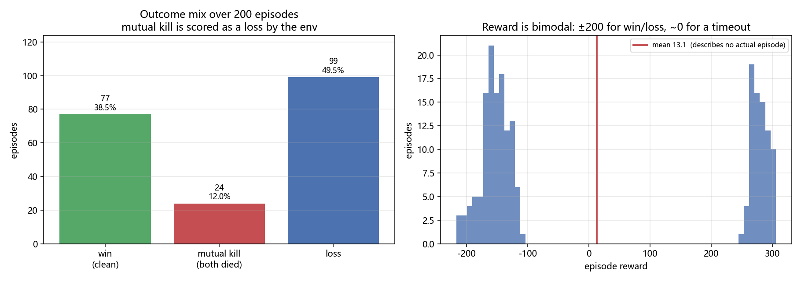

# Custom RL Environments — DQN and PPO

两个自己写的 Gymnasium 环境,用两种算法求解。**重点不在算法调参,而在环境设计与算法对比**:两个环境的观测形式不同(网格图像 vs. 向量),两个算法的实现层次也不同(从零手写 DQN 家族 vs. SB3 PPO)。

| 环境 | 观测 | 算法 | 结果 |
|---|---|---|---|
| **`pacman/`** 15×15 网格吃豆人 | 2/4 通道图像 | 手写 DQN 家族 | ✅ **解出**(平均吃掉 134.4/135 颗豆子) |
| | | SB3 PPO + 自定义 CNN | ❌ 未解出(评估奖励始终为负) |
| **`boss_duel/`** 回合制 BOSS 战 | 8 维向量 | SB3 PPO | ⚠️ 胜率 **38.5%**(未学会稳定取胜) |

这个对比本身就是结论:**在同一个吃豆人环境上,手写 DQN 解出了,PPO 没有。** 下面两份结果都是诚实的负面结论,不是挑出来的好看数字。

> **另见 [`FINDINGS.md`](FINDINGS.md)** —— 记录了这个项目里**六个把结论带偏的坑**,包括一个让 BOSS 战胜率从 38.5% 虚高到 50.5% 的判定顺序 bug、一处训练/评估环境不一致、以及"确定性评估其实带噪声"。每个数字我都返工过至少一次,那份文档说明了为什么现在的数字是可信的。

---

## 结果在哪

| 图 | 文件 |
|---|---|
| DQN 三联图(训练曲线 / 吃豆数 / 奖励分布) | `results/dqn_results.png` |
| 吃豆人 PPO 训练曲线 | `results/pacman_ppo_curve.png` |
| BOSS 战 PPO 训练曲线 | `results/boss_duel_curve.png` |

| 数据 | 文件 |
|---|---|
| DQN 训练日志(12 个记录点) | `results/dqn_training.csv` |
| DQN 三次评估逐局数据(各 2000 行) | `results/dqn_eval_*.csv` |
| DQN 评估汇总 | `results/dqn_eval_summary.json` |
| PPO 训练日志原始数据 | `pacman/ppo/pacman_tensorboard/`、`boss_duel/tensorboard/` |

重新生成:

```bash
python tools/plot_dqn.py                        # 从 results/*.csv
python tools/plot_ppo.py --which pacman         # 从 tensorboard 日志
python tools/plot_ppo.py --which boss_duel
```

`plot_ppo.py` 会同时打印**分段均值**(见下文说明为什么不能引用首末点)。

---

## 1. 吃豆人环境与 DQN

### `SimplePacmanEnv`

环境有两个版本,**不完全相同**:

| 属性 | DQN 版 | PPO 版 |
|---|---|---|
| 网格 | 15 × 15 | 15 × 15 |
| 豆子数 | `int(225 × 0.6)` = **135** | 同左 |
| 观测通道 | **2**(玩家 / 豆子) | **4**(玩家 / 幽灵 / 墙 / 豆子) |
| 幽灵 | **无**(`__init__` 不接受幽灵参数) | 有,`with_ghost` / `num_ghosts` |
| 墙 | 无 | 有,`with_walls` |
| 动作 | 4 个离散(上 / 下 / 左 / 右) | 4 个离散 |
| 每步惩罚 | **-0.05** | **-0.1** |
| 吃到豆子 | +1 | +1 |
| 清空棋盘 | +10 并终止 | +10 并终止 |
| 撞幽灵 | —(无幽灵) | **-10** |
| 超时 | 1000 步 | 1000 步 |

两版的观测通道数与每步惩罚都不同,所以**奖励数值不可跨版本比较**;可比的是"吃到豆子数"与"清盘所耗步数"。

### DQN 实现

不依赖 SB3,手写的组合:Dueling 网络 + Double DQN + Prioritized Experience Replay + NoisyNet(替代 ε-greedy)+ n-step 回报 + CNN 特征提取。

| 参数 | 值 |
|---|---|
| `GRID_SIZE` | 15 |
| `LEARNING_RATE` | 1e-7(`My_practice.ipynb` 为 1e-6) |
| `MEMORY_SIZE` | 50,000(`My_practice` 为 100,000) |
| `BATCH_SIZE` | 64 |
| `GAMMA` | 0.99 |
| 网络 | `QNetworkDuelingCNN`,3 层 Conv2d(2→32→64→64) + Dueling 头 `V + A - mean(A)` |

### DQN 结果



**训练日志**(`pacman/dqn/thesecond.ipynb` 第 10 个 cell,`train(agent, 500)`,每 20 轮打印一次,输出被截断在第 240 轮):

| Episode | Avg Reward | Avg Step | Avg Dots Eaten | |
|---|---|---|---|---|
| 19 | 134.03 | 203.45 | 134.20 | |
| **59** | **134.19** | 206.30 | **134.50** | ← 最佳,保存 best model |
| 99 | 134.06 | 206.90 | 134.40 | |
| 179 | 132.29 | 240.25 | 134.30 | |
| **199** | **122.66** | **293.85** | **128.35** | ← 明显退化 |
| 239 | 130.52 | 249.60 | 133.50 | |

这**不是从零训练**:该 cell 先 `load_state_dict("reward-model0.pth")` 再 `train(agent, 500)`,所以第 19 轮就已是 134 的水平。

最佳点在第 59 轮,**第 199 轮退化到 122.66**、平均步数从 206 涨到 294;之后第 219 轮又回升到 133.81,所以更像**震荡**而非单调崩塌。`best_model` 快照机制正是为此。

**评估**(三次 2000 局的运行,输出存在 notebook cell output 中,已提取为 CSV):

| 运行 | 加载权重 | 平均奖励 | 平均步数 | 平均吃豆 | 完美清盘率 |
|---|---|---|---|---|---|
| `My_practice` cell 11 | `reward-model01.pth` | 132.41 | 226.83 | 134.03 | 39.1% |
| `My_practice` cell 14 | `reward-model01.pth` | 134.06 | 206.16 | 134.37 | 38.6% |
| `thefirst` cell 13 | `threech1.pth`(3 通道) | 121.22 | 360.66 | 130.98 | 32.0% |

三个策略都接近清盘(棋盘共 135 颗豆子),但稳定性和速度差别很大——见图中 (c) 的奖励分布:

| 运行 | 奖励 sd | 步数 sd | 最短吃豆数 |
|---|---|---|---|
| cell 11 | 10.60 | 131.51 | 74 |
| cell 14 | **2.14** | **28.97** | 122 |
| cell 13 | 28.23 | 292.07 | 0 |

### ⚠️ 一个真实 bug:评估时不完全是确定性的

cell 11 与 cell 14 **加载完全相同的权重** `reward-model01.pth`,但奖励方差相差 **5 倍**(10.60 vs 2.14),cell 11 甚至出现跑满 1000 步上限、只吃到 74 颗豆子的 episode。

原因在 `DQNAgent.select_action`:

```python
def select_action(self, state):
    self.policy_net.train()   # ← 问题在这里
    state = torch.FloatTensor(state).unsqueeze(0).to(device)
    with torch.no_grad():
        q_values = self.policy_net(state)
        return q_values.argmax().item()
```

`valid()` 里调用了 `agent.policy_net.eval()`,但**每次 `select_action` 都把它改回 `train()`**。网络使用 `NoisyLinear`,训练模式下噪声层会重新采样——于是"评估"时噪声仍在起作用。

**修复方式是把 `select_action` 里的 `.train()` 删掉**,由调用方决定模式。这个 bug 没有修——仓库里保留的是当时的原始运行结果。所以上表里的评估数字**不是确定性策略的表现**,真实确定性表现应当更好且方差更小。

---

## 2. 吃豆人上的 PPO



SB3 PPO + **自定义 CNN 特征提取器**(继承 `BaseFeaturesExtractor`,处理 4×15×15 输入)。

| 参数 | 值 |
|---|---|
| 策略 | `CnnPolicy` + `SmallGridFeatureExtractor` |
| `learning_rate` | 2.5e-4 |
| `n_steps` / `batch_size` / `n_epochs` | 256 / 64 / 4 |
| `gamma` / `gae_lambda` / `clip_range` | 0.99 / 0.95 / 0.2 |
| `ent_coef` | 0.01 |

日志被切在 **PPO_1 与 PPO_2 两个目录、共 6 个 event 文件**里,是多次训练尝试留下的,步数区间互相重叠、并非一条干净的时间线。

### ⚠️ 不要引用首末点

`eval/mean_reward` 的标准差是 **29.88**。在这种噪声下,序列的最后一个值只是它恰好落在哪里。下表是**分段均值**(等分 5 段):

| 指标 | 段1 | 段2 | 段3 | 段4 | 段5 | sd |
|---|---|---|---|---|---|---|
| `eval/mean_reward` | -70.81 | -40.41 | -25.39 | -19.53 | **-22.38** | 29.88 |
| `rollout/ep_rew_mean` | +0.60 | +7.98 | +24.07 | +35.42 | **+42.57** | 20.19 |
| `eval/mean_ep_length` | 778.14 | 582.84 | 613.06 | 601.56 | **631.29** | 163.79 |

- **`rollout/ep_rew_mean` 稳定上升**(+0.6 → +42.6),策略在训练分布上确实在改进。
- **`eval/mean_reward` 只回升到 -22**,始终为负。
- `eval/mean_ep_length` 约 600~780 步(上限 1000),评估时经常走满步数而未清盘。

**结论:PPO 这个配置没能解出这个环境**,而手写 DQN 能清盘。

---

## 3. BOSS 战环境与 PPO

### `BossDuelEnv`

| 属性 | 值 |
|---|---|
| 动作空间 | `Discrete(4)` — 普通攻击 / 格挡 / 闪避 / 大招 |
| 观测空间 | `Box(8,)`,归一化到 [0,1] — BOSS 动作 one-hot + 双方血量 / 能量 / 体力 |
| 回合上限 | 50 步 |
| 玩家血量 | 100 |
| BOSS 血量 | 200 |

BOSS 行为是随机的,动作概率 `[0.4, 0.5, 0.1]`(`BossDuelEnv.py:23`),且**每一步重新采样**——因此不存在可被记忆的固定出招模式,策略必须学会对 BOSS 当前动作作出反应。

奖励塑形(`BossDuelEnv.py` 的 `step()`):

| 事件 | 奖励 |
|---|---|
| 格挡成功 | +10 |
| 大招命中 | `damage × 0.1` 且额外 +5 |
| 普通攻击命中 | `damage × 0.1` |
| 闪避成功 | +1 |
| 受到伤害 | `-damage × 0.2` |
| 战败 | -200 |
| 胜利 | +200 |
| 达到 50 步上限(平局) | `(玩家血量 - BOSS 血量) / 10` |

平局奖励按血量差给分而不是固定值,因此策略即使打不死 BOSS,也有动机尽量保持血量领先。

### 结果

训练曲线:



**但这条曲线几乎读不出结论。** `eval/mean_reward` 的标准差高达 **92.43**,而这里的奖励是双峰的(赢 +200 / 输 −200 / 平局 ≈0),所以"均值"是个混合体的数字,不描述任何单独一局。

要真正知道策略表现如何,必须**直接统计胜负**。用 `tools/eval_boss_duel.py` 跑 200 局(确定性策略,训练用的 200 血环境):



| 结局 | 局数 | 比例 |
|---|---|---|
| 干净赢(我方存活、BOSS 阵亡) | **77** | **38.5%** |
| 同归于尽(同一回合双方都死) | 24 | 12.0% |
| 干净输(我方先死) | 99 | 49.5% |
| 平局(打满 50 步) | **0** | **0%** |

按环境自身的奖励语义(我方死亡优先于 BOSS 死亡,见 `BossDuelEnv.py:158`),**同归于尽算输**:

> **有效胜率 38.5%,败率 61.5%,平局 0%。**
>
> 平均奖励 **13.13**(sd 212.12)—— 这个微正的数字是"约 38% 赢 ~+280"与"约 62% 输 ~−150"相抵的结果,不代表"平均小胜"。

**诚实的结论**:策略从完全不会(随机策略奖励约 −200,即必输)进步到了**大约每 3 局赢 1 局**,但**始终没有超过这个水平**。它不是"谨慎的幸存者"——200 局里**没有一局**打到 50 步上限,最长 48 步;**每一局都以某一方死亡告终**。12% 的局打成同归于尽。

一个容易误读的细节:平均回合长度从 43 降到 36,**不是**因为"学会了更快取胜",而是因为后期双方都死得更快——这个下降同时包含"赢"和"输"。

### 训练过程中的分段均值

| 段 | 1 | 2 | 3 | 4 | 5 |
|---|---|---|---|---|---|
| `eval/mean_reward` | -10.64 | -1.45 | +27.71 | +10.32 | **+31.77** |
| `eval/mean_ep_length` | 43.11 | 40.06 | 36.66 | 35.74 | **36.49** |

奖励在约 200 万步后就升到 0 附近,之后 1300 万步基本停滞。

另外两点:

- `rollout/ep_rew_mean` 分段均值为 -1.72 → +15.14,与 `eval` 同向但幅度小得多;两者都**不能替代胜负统计**。
- `train/explained_variance` 收在 **0.550**,价值函数只解释了约一半的回报方差——这是策略停在 38.5% 的直接原因。

### 复现这个统计

```bash
python tools/eval_boss_duel.py --model <path/to/ppo_treth.zip> -n 200
```

逐局结果存到 `results/boss_duel_outcomes.csv`(含每局结局、奖励、步数、双方剩余血量)。

> **一个曾经的坑**:这个脚本最初先判 `boss_health <= 0` 再判 `agent_health <= 0`,把 24 局同归于尽全算成了赢,得出错误的 50.5% 胜率。已按环境的判定顺序修正。

---

## 目录

```
FINDINGS.md              六个被返工的结论,以及每个是怎么发现的
README.md                本文件
pacman/
  dqn/
    thesecond.ipynb      唯一含真实训练日志的版本(train(agent,500),记录到第 240 轮),LR=1e-7
    My_practice.ipynb    两次 2000 局评估(cell 11 / cell 14,同一权重),LR=1e-6
    thefirst.ipynb       更早的实验:LR=1e-7,评估加载 3 通道权重 threech1.pth
    result.ipynb         环境与网络定义片段(无输出)
    demonstrate.ipynb    逐帧渲染演示(文本形式打印棋盘)
  ppo/
    train1.ipynb         环境 + 自定义特征提取器 + PPO 训练
    pacman_tensorboard/  TensorBoard 训练日志
boss_duel/
  BossDuelEnv.py         环境定义(可独立 import)
  train.ipynb            环境定义 + PPO 训练
  train1.ipynb           训练(含续训)
  valid.ipynb            评估
  enery.ipynb            早期试验
  tensorboard/           TensorBoard 日志(PPO_6,规模最大的一次运行)
results/                 全部图表与数据表
tools/
  plot_dqn.py            由 results/*.csv 生成 DQN 三联图
  plot_ppo.py            由 tensorboard 日志生成 PPO 曲线(需 --which)
```

## 复现

```bash
pip install gymnasium stable-baselines3 torch numpy matplotlib tensorboard
jupyter notebook

python tools/plot_dqn.py
python tools/plot_ppo.py --which pacman
python tools/plot_ppo.py --which boss_duel
```

`pacman/dqn/` 下的 notebook 不依赖 stable-baselines3,只需 gymnasium + torch。

### 模型权重

仓库不含 `.pth` 权重(单个 150~250 MB,因为保存的是 `torch.save(agent)` 整个对象而非 `state_dict`)。引用的权重文件名:`reward-model0.pth`(thesecond 续训起点)、`reward-model01.pth`(My_practice 评估)、`threech1.pth`(thefirst 评估)。

`boss_duel/tensorboard/` 里只保留了 PPO_6(完整的 300 点运行)。同一目录下另有 PPO_1~PPO_5,每个只有 1~2 个评估点、奖励约 -213(与随机策略相当),属废弃的短跑。
